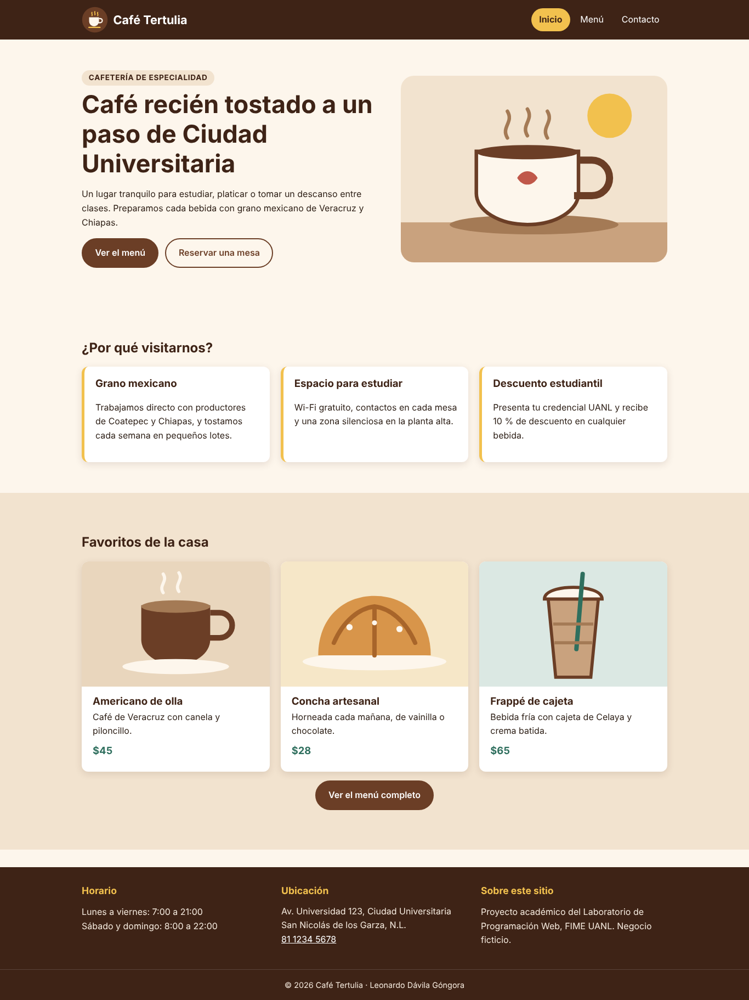
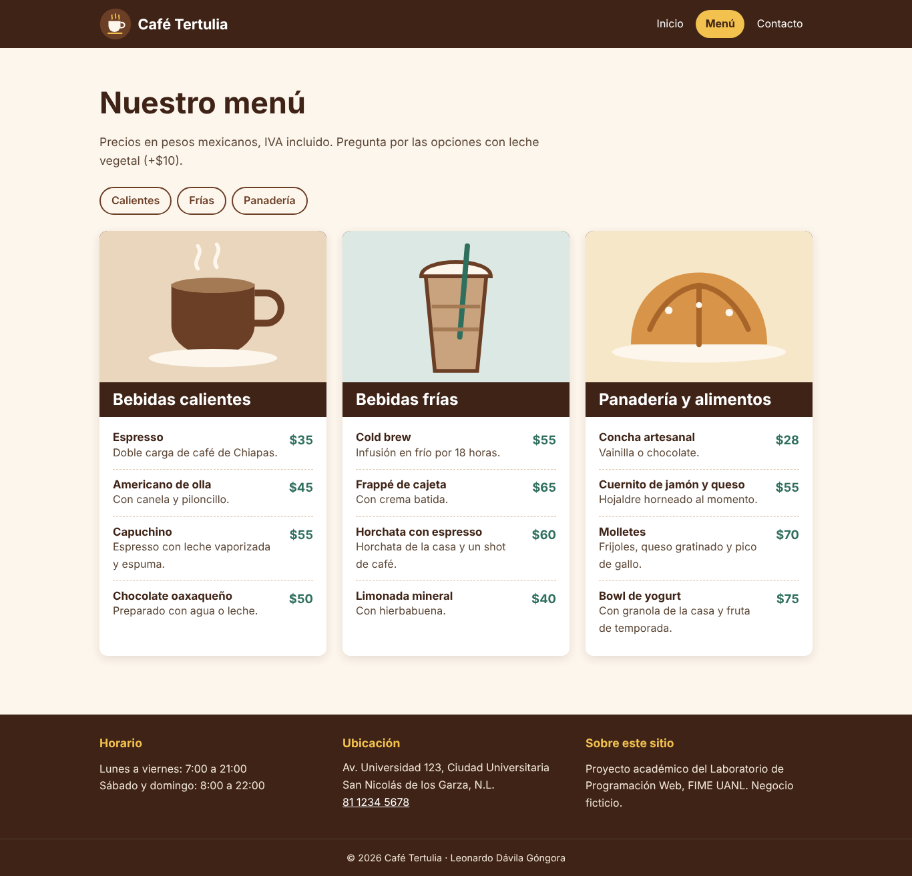
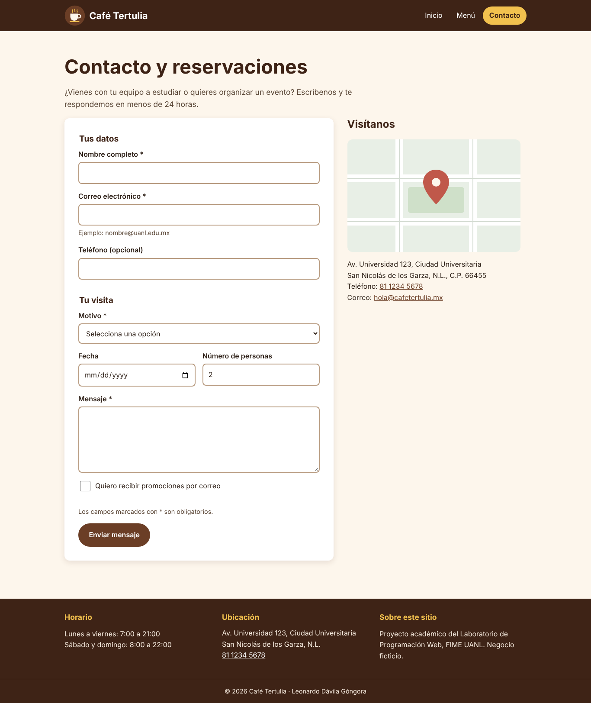
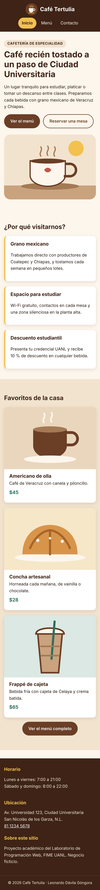
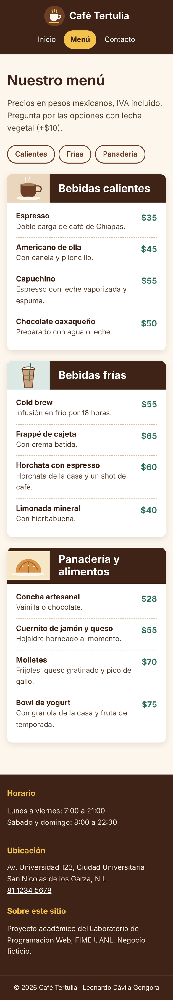
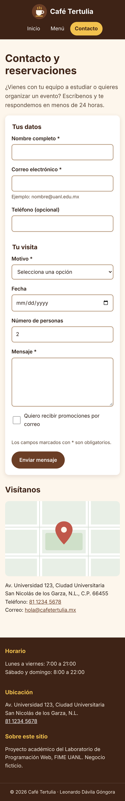

# Café Tertulia: sitio web responsivo, semántico y accesible

**Actividad 2. Laboratorio de Programación Web (FIME, UANL)**
Alumno: Leonardo Dávila Góngora · Matrícula 2145945 · Grupo 406

🔗 **Sitio publicado:** https://leyesdavila.github.io/Cafe-Generico/

📦 **Repositorio:** https://github.com/leyesdavila/Cafe-Generico

## Objetivo

Construir y publicar un sitio web responsivo para un pequeño negocio usando HTML5 semántico y CSS moderno (Flexbox y Grid), aplicando principios básicos de usabilidad, accesibilidad y validación de estándares.

El caso elegido es **Café Tertulia**, una cafetería ficticia frente a Ciudad Universitaria que necesita una presencia web que se vea bien en computadora y en teléfono.

## Páginas

| Página | Archivo | Contenido |
|---|---|---|
| Inicio | `index.html` | Presentación del negocio, ventajas y productos destacados |
| Menú (productos) | `menu.html` | Bebidas calientes, bebidas frías y panadería con precios |
| Contacto | `contacto.html` | Formulario de contacto/reservación con etiquetas y datos de ubicación |
| Confirmación | `gracias.html` | Mensaje que se muestra al enviar el formulario (sitio estático, no guarda datos) |

## Tecnologías

- **HTML5 semántico:** `header`, `nav`, `main`, `section`, `article`, `aside`, `address` y `footer`.
- **CSS3:** variables CSS, **Flexbox** (barra de navegación, botones, tarjetas de producto, renglones del menú) y **CSS Grid** (hero, rejillas de tarjetas, menú, formulario y pie de página). No se usan tablas para el diseño.
- **Diseño responsivo "mobile first"** con dos breakpoints: `600px` (tableta) y `900px` (escritorio).
- **Imágenes SVG** propias, ligeras y escalables.
- Sin frameworks ni JavaScript.
- Herramientas: Visual Studio Code, Git/GitHub, GitHub Pages, Nu HTML Checker (W3C) y navegador Chromium.

## Estructura

```
├── index.html
├── menu.html
├── contacto.html
├── gracias.html
├── css/
│   └── estilos.css
├── img/          (logo e ilustraciones SVG)
└── capturas/     (capturas de escritorio y móvil)
```

## Accesibilidad y usabilidad aplicadas

- Atributo `lang="es"` y `<meta name="viewport">` en cada página.
- Texto alternativo (`alt`) descriptivo en todas las imágenes con contenido; el logo decorativo usa `alt=""` porque el nombre ya aparece en texto.
- Jerarquía de encabezados ordenada: un solo `h1` por página, luego `h2` y `h3`.
- Formulario con `label` asociado a cada campo (`for`/`id`), campos agrupados con `fieldset` y `legend`, campos obligatorios con `required`, texto de ayuda enlazado con `aria-describedby` y `autocomplete` para nombre, correo y teléfono.
- Enlace "Saltar al contenido principal" para usuarios de teclado y lector de pantalla.
- Navegación con `aria-label` y la página actual marcada con `aria-current="page"`.
- Foco visible (`:focus-visible`) en enlaces, botones y campos.
- Contraste de color que cumple WCAG AA (texto café oscuro sobre crema, texto blanco sobre café).
- Tipografía en `rem` y anchos fluidos: no hay desplazamiento horizontal en móvil.

## Capturas

### Escritorio (1366 px)

| Inicio | Menú | Contacto |
|---|---|---|
|  |  |  |

### Móvil (iPhone 13, 390 px)

| Inicio | Menú | Contacto |
|---|---|---|
|  |  |  |

## Resultados de validación

| Archivo | Herramienta | Resultado |
|---|---|---|
| `index.html` | Nu HTML Checker (W3C) | ✅ Sin errores ni advertencias |
| `menu.html` | Nu HTML Checker (W3C) | ✅ Sin errores ni advertencias |
| `contacto.html` | Nu HTML Checker (W3C) | ✅ Sin errores ni advertencias |
| `gracias.html` | Nu HTML Checker (W3C) | ✅ Sin errores ni advertencias |
| `css/estilos.css` | Validador CSS del Nu Checker (W3C) | ✅ Sin errores |
| Las 4 páginas | axe-core 4 (accesibilidad) | ✅ 0 infracciones en escritorio y en móvil |

Errores corregidos durante el desarrollo: ninguno pendiente. Se revisó además que ninguna página genere desplazamiento horizontal entre 320 px y 1366 px de ancho.

## Cómo verlo localmente

Basta con abrir `index.html` en el navegador. No requiere servidor ni instalación.

## Créditos

Proyecto académico. Café Tertulia es un negocio ficticio; las ilustraciones fueron creadas para este sitio.
